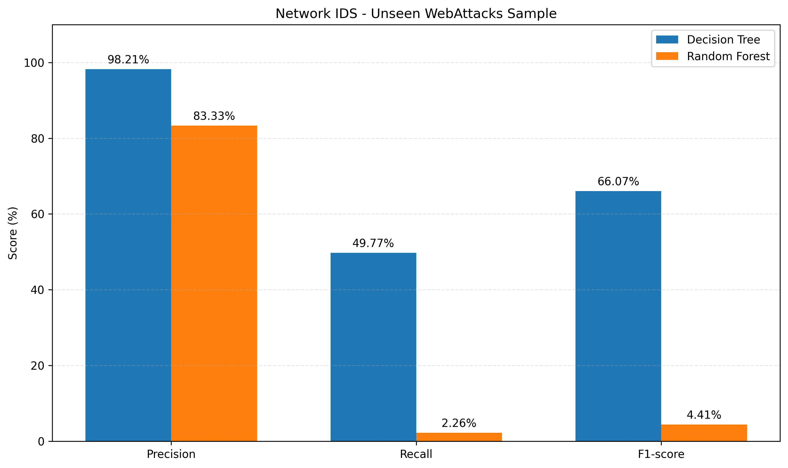
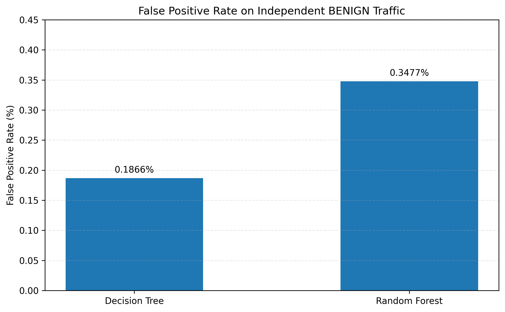

# Network IDS - Model Comparison Report

## 1. Random 80/20 Train-Test Split

| Metric | Decision Tree | Random Forest |
|---|---:|---:|
| Accuracy | 99.83% | 99.69% |
| Macro F1-score | 96.17% | 94.69% |
| Test samples | 324,833 | 324,833 |

## 2. Independent BENIGN Traffic Test - Monday

| Metric | Decision Tree | Random Forest |
|---|---:|---:|
| Valid rows | 529,481 | 529,481 |
| False positives | 988 | 1,841 |
| False positive rate | 0.1866% | 0.3477% |

All valid rows in this test were labeled BENIGN.

## 3. Unseen WebAttacks Sample Test

Dataset: dashboard_attack_test.csv  
Total rows: 421  
Ground-truth BENIGN rows: 200  
Ground-truth ATTACK rows: 221  

| Metric | Decision Tree | Random Forest |
|---|---:|---:|
| Precision | 98.21% | 83.33% |
| Recall | 49.77% | 2.26% |
| F1-score | 66.07% | 4.41% |
| False positive rate | 1.00% | 0.50% |
| True positives | 110 | 5 |
| False positives | 2 | 1 |
| False negatives | 111 | 216 |
| True negatives | 198 | 199 |

## 4. Interpretation and Limitations

Decision Tree performed better than Random Forest on the reported random split and on the independent tests described above.

The random split may produce optimistic estimates if related traffic flows occur in both training and test sets. The Monday test measures false alarms on benign traffic. The WebAttacks sample evaluates binary attack detection on attack types not represented among the model's ten training classes.

These results do not establish general performance on all unseen attacks. The WebAttacks sample is limited, and its results should be reported separately from the random-split metrics.

The binary evaluation treats any predicted class other than BENIGN as an alert. It evaluates attack-versus-benign detection, not correct identification of the exact attack type.

## 5. Current Conclusion

Decision Tree is the stronger candidate based on the current experiments. Further evaluation on independent files and additional attack types is recommended before making claims about real-world deployment.

## 6. Generated Visualizations

### 6.1 Unseen WebAttacks Comparison

This figure compares binary attack-detection Precision, Recall and F1-score
for Decision Tree and Random Forest on the 421-row WebAttacks sample.

### 6.2 False Positive Rate on BENIGN Traffic

This figure compares false positive rates on the independent Monday BENIGN
traffic file. Decision Tree produced fewer false alarms in this experiment.

## 7. Files

- `model_comparison.md`: Main comparison report.
- `webattacks_model_comparison.png`: WebAttacks metric comparison.
- `monday_false_positive_comparison.png`: BENIGN traffic false positive rate comparison.

